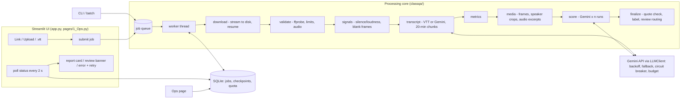

# Design: 8x8 Class Quality Assessor

*Status: prototype running on Streamlit Community Cloud. This document covers the production path. Cost and
throughput figures are **estimates** from tokens measured in our own runs and list prices. They are not quotes.*

## 1. Problem and goals

8x8 runs many small-group online chess classes for children. Today, reviewers watch recordings and write short
feedback. We want a system that rates a class **Poor / Average / Good / Excellent** and explains the rating with
evidence a reviewer can check in seconds.

**Goals**
- G1. Useful, checkable assessments. Every claim has a timestamp and a quote or frame reference, and coaching
  tips are concrete.
- G2. Labels that match 8x8's own bar. The rubric is derived from 8x8 reviewer feedback and calibrated on labelled
  classes.
- G3. Trust over false certainty. Uncertain results go to a human review queue and are not presented as final.
- G4. Reliable and cheap at hundreds to thousands of classes a week. Failures are explicit, retries are cheap and
  idempotent, and cost per class is bounded.
- G5. Privacy by default. Recordings of minors are processed only by the approved model vendor and are deleted
  after the job.

**Non-goals (for now)**
- Replacing human reviewers. The system triages and drafts; humans decide on edge cases.
- Real-time or in-class feedback.
- Training a custom model. With 10 labelled classes, a prompted multimodal model plus a calibrated aggregation
  is the right size of tool.
- Teacher-facing performance management. Outputs are coaching aids until validated on far more data.

## 2. Architecture

- **UI is presentation only.** `app.py` submits a job and polls the job row. Rendering lives in
  `ui/report_view.py`. All processing is in `classqa/`, so the same core serves the CLI, batch runs, the eval
  harness and tests.
- **Job model** (`classqa/store.py`): `queued → extracting → transcribing → scoring → done | needs_review | failed`.
  Every job stores its progress, a user-facing error code and message, usage (calls, tokens, estimated cost,
  per-stage seconds), review reasons, and the full versioned result.
- **Worker** (`classqa/worker.py`): a background thread pulls job ids from a queue and runs `pipeline.run(ctx)`.
  The `finally` block always deletes the job's media directory and any Gemini Files uploads.
- **Idempotent checkpoints.** The key is `(sha256 of input file + transcript, stage, version)`. Transcription
  chunks and every scoring run are checkpointed, so a retry resumes from the last finished stage and re-running
  the same recording costs $0. The version key includes the prompt version, rubric hash, model and number of
  frames/excerpts, so any change to the inputs invalidates the cache correctly.
- **Swappable persistence.** `JobStore`, `CheckpointStore` and `QuotaStore` are small protocols. SQLite (WAL,
  thread-safe) is the prototype backend.

### Production mapping

| Prototype | Production |
|---|---|
| SQLite `jobs` | Postgres (jobs and results; JSONB for reports), with row-level access for reviewers |
| SQLite `checkpoints` | Postgres for small JSON; object storage (GCS/S3) for transcripts, with a **7-day lifecycle TTL** |
| SQLite `quota` | Redis `INCR` with expiry (per model, per day) and a token-bucket RPM limiter shared across workers |
| in-process queue + thread | Cloud Tasks / Pub/Sub (or Celery + Redis) feeding autoscaled Cloud Run jobs. Same `JobRunner.process()` body |
| per-job temp dir | ephemeral worker disk. Media fetched from a signed URL and never persisted beyond the attempt |
| Streamlit Ops page | Grafana/Looker on the JSON logs + jobs table; alerting on failure rate, review rate, cost/class |

## 3. Data flow (one class)

1. **Ingest.** A link is streamed to disk in 1 MB chunks (never held in memory). The download enforces the size
   limit, reports progress, and resumes with HTTP `Range` after a dropped connection. Drive links use the
   `usercontent` endpoint with `confirm=t` (it skips the large-file warning page), with `gdown` as a fallback.
   Browser uploads go to the job dir in 8 MB chunks.
2. **Validate before spending.** ffprobe checks format, corruption, duration (1 min to 3 h), size (≤ 2 GB) and
   that an audio track exists. ffmpeg loudness rejects silent recordings. No API call happens until all of this
   passes.
3. **Transcript.** If a Zoom `.vtt` is provided and usable, it is used. Otherwise Gemini (flash-lite) transcribes
   mono 16 kHz 32 kbps audio in 20-minute chunks, three in parallel, with speaker roles. Display names become
   `Teacher` / `Student N` before anything is sent for scoring.
4. **Signals.** Interaction metrics are computed in code. Twelve frames plus upscaled top-right speaker crops
   cover background, face and camera. Four 90-second audio excerpts cover tone, energy and audio quality. If
   frames or excerpts fail, the job continues and records `missing_signals`.
5. **Score.** One (or n, for self-consistency) Gemini call per run. The response is validated against a Pydantic
   schema. It contains a visual check, concerns listed first, six dimension scores with evidence, strengths,
   improvements with coaching tips, severity-tagged red flags, a holistic label and a confidence.
6. **Finalize (deterministic).**
   - Every evidence quote is verified against the full transcript (exact or ≥ 0.8 fuzzy match). Quotes that
     can't be found are removed and flagged.
   - The label comes from fixed weights and thresholds. A major red flag caps the label at Average.
   - Confidence is downgraded when signals are missing or runs disagree.
   - Routing rules decide `done` vs `needs_review`.
7. **Result.** The report is stored with `versions` (pipeline, prompt, rubric hash, thresholds), the model used,
   and usage and cost, so any rating can be audited and reproduced later.

## 4. Key decisions and trade-offs

| Decision | Alternatives considered | Why this one / trade-off |
|---|---|---|
| **Gemini multimodal (audio + frames + transcript)** | Transcript-only LLM; Whisper + separate vision model; training a classifier | 8x8 feedback is about background, face, camera, energy and A/V quality as much as content. Transcript-only scoring rated "quality issue" classes Good/Excellent (eval v2). One vendor keeps the data-processing agreement simple. Trade-off: vendor dependence and free-tier quotas, mitigated by the fallback chain and model config via env. |
| **Rubric derived from 8x8 feedback** | Generic teaching rubrics (e.g. CLASS, Danielson) | Labels are 8x8's, so the rubric must encode 8x8's bar: rapport/intro, energy, setup, homework. Weights follow how often a theme decides a label in the feedback. Trade-off: built from 10 examples, so it needs re-validation as more labelled data arrives. |
| **LLM scores, code decides the label** | Ask the LLM for the label directly | Code-side aggregation is auditable, versioned, stable across runs, and can be recalibrated without new API calls (`eval/rescore.py`). The model's own holistic label is kept as a disagreement signal. Trade-off: thresholds are fitted on little data (leave-one-out reported). |
| **Human review queue (`needs_review`)** | Always output a label; refuse when unsure | A wrong confident label costs more than a 2-minute human check. The model gives scores for review instead of refusing, and reviewers see *why* a class was routed. Trade-off: 6/10 eval classes would be routed today. The margin is configurable so routing can match reviewer capacity. |
| **Quote verification in code** | Trust the model; ask the model to self-check | Hallucinated evidence would destroy reviewer trust. String matching is cheap and deterministic. On saved eval outputs, 141/144 quotes verified (3 removed). |
| **Flash-lite models by default** | gemini-3-flash / 3.6-flash / 3.1-pro | Best *complete* eval run (5/10 exact, 9/10 within one) and a usable quota. The larger flash models share a ~20 requests/day free-tier pool and returned many 429/503s. Trade-off: flash-lite compresses scores, and a better model on a paid tier is worth re-evaluating (roadmap). |
| **Idempotent checkpoints by content hash** | Retry whole jobs; no caching | A retry after a 503 at the scoring stage should not re-pay for transcription. Re-submitting the same file is free. Trade-off: transcripts at rest, limited by pseudonymisation plus a TTL. |
| **Link path recommended for big files** | Browser upload only | Streamlit holds uploads in memory and proxied uploads can stall (seen live with a 54 MB file). Server-side streaming with resume is robust and scales to 2 GB. |
| **Thread worker inside Streamlit** | Separate worker service | Streamlit Cloud is a single container. A daemon thread plus SQLite works there and keeps the UI responsive. The same `process()` moves unchanged into a queue worker in production. |
| **Deterministic settings** | temperature 0 | A fixed `seed` plus vendor-default temperature (Gemini 3 guidance warns against low temperatures). Variance is handled explicitly with optional self-consistency (n=2) and disagreement routing. |

## 5. Failure modes

Every failure ends in a terminal state with a stable `error_code` (shown on the Ops page) and a plain-language
message. "Tested" refers to `tests/` (fakes and synthetic media, no API calls).

| Failure | Detection | Handling | What the user sees | Tested |
|---|---|---|---|---|
| Unsupported / non-media file | extension + ffprobe | reject before API spend | "Unsupported file type…" | ✅ |
| Corrupt / truncated media | ffprobe error, no duration | reject | "File looks corrupt…" (`corrupt_media`) | ✅ |
| Too short / too long / too large | duration < 60 s / > 3 h; size > 2 GB (also enforced *while* downloading) | reject; download aborted early | limit stated | ✅ |
| No audio track | ffprobe streams | reject | `no_audio` | ✅ |
| Silent audio (muted capture) | ffmpeg volumedetect (max < −45 dB) | reject | `silent_audio` | ✅ |
| No video track (audio file) | ffprobe | continue without visual checks; confidence capped; routed to review | "Assessed without video frames" | ✅ |
| Frames / excerpts extraction fails | exception in media stage | continue, `missing_signals` recorded | info banner and review reason | ✅ (audio-only path) |
| **Large browser upload stalls** | upload never completes (Streamlit holds uploads in memory; proxies time out) | `maxUploadSize=400`; UI recommends the **Link** tab above ~200 MB; uploads streamed to disk in 8 MB chunks | guidance under the uploader; Link tab is the default tab | manual (live) |
| Drive file not shared / 401/403/404 | HTML sign-in page or HTTP status; gdown "permission" | stop, no retry | "Share as *Anyone with the link*" (`drive_permission`) | ✅ |
| Drive download quota / HTTP 429 | gdown "too many users" / 429 | stop with advice | `drive_quota` | ✅ |
| Dropped connection mid-download | exception during stream | resume with HTTP Range (3 retries, backoff) | progress continues | ✅ |
| Folder link / web page instead of file | URL pattern / `text/html` | reject | "Share the file, not the folder" | ✅ |
| Gemini 429 (per-minute) / 503 / timeout / disconnect | error classification | exponential backoff with full jitter (cap 60 s), up to 5 attempts | progress message "model busy, retrying" | ✅ |
| Gemini daily quota exhausted for a model | 429 "per day" | breaker opened hard for that model; next model in the chain | transparent; model used shown in the report | ✅ |
| Repeated failures on a model | circuit breaker (5 consecutive) | model paused for 2 min; fallback chain; all open → `circuit_open` | "AI paused briefly, retry in a few minutes" | ✅ |
| All models unavailable | chain exhausted | job `failed` (`llm_unavailable`); retry reuses checkpoints | Retry button (link jobs) | ✅ |
| Invalid API key | 400/401/403 auth | fail fast, no retries | `llm_auth` | ✅ |
| Malformed / out-of-schema JSON | Pydantic validation | one repair retry with the validation error; then `malformed_output` | structured failure, no guessed result | ✅ |
| Hallucinated evidence quote | quote not found in transcript | quote removed and marked; > ⅓ unverified → review | "⚠️ not in transcript" badge | ✅ |
| Low confidence / holistic vs rubric ≥ 2 levels / borderline score / self-consistency disagreement / major red flag | trust layer rules | `needs_review` with reasons | yellow banner listing reasons | ✅ |
| Runaway cost (very long file, loops) | per-job token (2 M) and cost ($0.50) budget | stop the job | `budget_exceeded` | ✅ |
| Daily spend / quota | global daily request guard (400/day default) | new calls refused | `daily_quota` | ✅ |
| App restart mid-job | stale non-terminal jobs on startup | marked `worker_restarted`; media deleted; retry resumes from checkpoints | message + retry | ✅ (logic) |
| Unexpected exception | catch-all in worker | `internal_error`; traceback in JSON logs only | generic message | ✅ |

## 6. Reliability of the rating

- **Versioning.** Every result stores `pipeline`, `prompt` (`v4`), a `rubric` content hash and the thresholds,
  plus the model that answered. Changing any of these invalidates checkpoints and is visible in the report and
  in audits.
- **Self-consistency (optional, n=2).** Dimension scores are averaged; if the two runs land on different labels,
  confidence goes to Low and the job is routed to review. It is off by default because it doubles scoring cost.
- **Deterministic aggregation.** The same scores always give the same label. `eval/rescore.py` re-applies
  aggregation to stored outputs.

## 7. Observability

- Structured JSON logs (`classqa/obs.py`) carry `job_id` on every line: `stage_start/stage_end` (seconds),
  `llm_call` (model, tokens, estimated cost, latency), `llm_error` (kind, attempt), `circuit_open`,
  `checkpoint_hit`, `job_finished/failed`, `media_deleted`. Context variables are propagated into the
  transcription thread pool.
- The **Ops page** shows jobs by status, failure reasons, review rate, average cost/time/tokens per class,
  requests today vs the guard, circuit-breaker state, and per-stage latency.
- Production alerts: failure rate > 5 % per hour, review rate drift, cost per class over budget, p95 latency.

## 8. Scaling and cost (estimates)

Measured:
- End-to-end job via a Drive link on a 38-minute class, without a transcript: 3 successful calls (plus 5
  transient 503s, retried), 100.7 k input / 16.9 k output tokens, 122 s wall time.
- Eval scoring calls: about 45 k input / 4.6 k output tokens each.

| Scenario (per 60-min class) | Calls | Tokens in / out | Est. cost (flash-lite list price $0.10 / $0.40 per M) | Est. cost on a flash-class model ($0.50 / $3.00) |
|---|---|---|---|---|
| With Zoom `.vtt` | 1 | ~45 k / ~5 k | ~$0.007 | ~$0.04 |
| Gemini transcription | 4 | ~135 k / ~23 k | ~$0.02 | ~$0.14 |
| + self-consistency (n=2) | 5 | ~180 k / ~28 k | ~$0.03 | ~$0.17 |

- **Per 1,000 classes**: about **$7–30** on flash-lite, or **$40–170** on a flash-class model, plus compute
  (ffmpeg, about 30 s CPU per class).
- **Throughput.** One worker does about 25–30 classes per hour, bounded by model latency. 1,000 classes a week is
  about 35–40 worker-hours, so 4 parallel workers clear a week's backlog in a working day. The real limit is the
  vendor RPM/TPM quota, not compute: a paid tier and a shared Redis rate limiter are prerequisites for scale.
- **Cost controls.** Per-job budget, daily guard, checkpoint reuse (re-runs are free), the `.vtt` path when
  available (about 3× cheaper), and self-consistency only on borderline cases (roadmap).

## 9. Privacy and compliance

- **Media lifetime.**
  - Uploads and downloads live only in `jobs/<id>/` and are deleted in the worker's `finally` on success *and*
    failure.
  - Audio is sent inline. Clips over 15 MB would go through the Gemini Files API and are deleted right after the
    job; Gemini also auto-expires files after 48 h.
  - Nothing is written outside the job dir except checkpoints.
- **Checkpoints and PII.**
  - Checkpoints hold pseudonymised transcripts and model JSON. Zoom display names, and their occurrences in the
    text, are replaced with `Teacher` / `Student N`.
  - Names spoken aloud may remain in Gemini transcripts. The scoring model is instructed never to output names.
  - Checkpoints are purged after 7 days (`CLASSQA_CHECKPOINT_TTL_S`).
  - Logs never contain transcript text.
- **Repository.** No recordings, transcripts, feedback PDFs, keys or tokens. `.gitignore` covers media, `.vtt`,
  `.cache/`, `eval/runs/` and secrets. CI runs with no key.
- **Vendor approval.** The brief says recordings may be processed only with services the organiser permits. Before
  production use with real children's data, **8x8/Humaniti must approve Google Gemini as a processor**: a data
  processing agreement, data residency, a paid tier (free-tier data may be used to improve Google products), and
  retention settings. Until then the hosted demo should be used only with recordings the organiser has cleared.

## 10. Evaluation and its limits

See `eval/EVALUATION.md`.
- **Final setup:** 7/10 exact and 9/10 within one level in-sample. With leave-one-out thresholds it is 5/10 exact.
- **Quality-issue classes:** both are rated Poor once media signals are used.
- **Trust layer, offline on saved outputs:** 141/144 quotes verified; 6/10 classes routed to review, catching
  2 of the 3 misclassified; 3/4 auto-accepted classes correct.
- **Limits:**
  - Only 10 labelled classes, 2 per label.
  - Thresholds are fitted on the same data.
  - Run-to-run variance is about ±0.4 on the weighted score.
  - The background check is not yet stable (QI-1 in full mode).

## 11. Roadmap

1. **More labelled data.** 50–100 classes with reviewer labels. Re-fit thresholds and weights with
   cross-validation and track agreement (Cohen's κ) against human reviewers.
2. **Dedicated visual checks.** 8x8-logo template matching and face detection on the speaker crop, so the
   background/face check is deterministic instead of LLM-judged.
3. **Selective self-consistency.** Run the second scoring pass only for borderline classes, at about +15 % cost
   instead of +100 %.
4. **Paid tier and model bake-off.** Rerun the eval on larger models with full quota and pick per stage on
   accuracy per dollar.
5. **Reviewer loop.** Reviewers accept or override in the UI, and overrides become labelled data and calibration
   drift alerts.
6. **Production deployment.** Postgres, object storage with TTL, Cloud Tasks with Cloud Run workers, a Redis
   rate limiter, SSO for reviewers, and an audit log.
