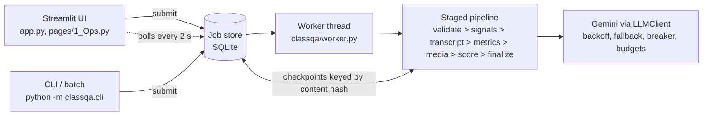
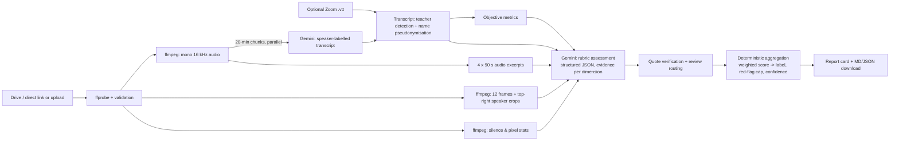

# ♟️ 8x8 Class Quality Assessor

A Streamlit app that takes a recorded online class from **8x8** (an online chess academy for children), rates it
**Poor / Average / Good / Excellent**, and explains the rating with **specific, timestamped, quoted evidence** and
coaching tips for the teacher.

Built for the HUMANITI AI "Can You Teach AI to Recognise a Great Class?" challenge.

## What it does

1. You paste a Google Drive / direct link (**recommended**, especially for files over ~100 MB) **or** upload a
   recording (mp4/mov/mkv/webm or audio). You can also attach the Zoom `.vtt` transcript, which is faster and
   uses less API quota.
2. The app produces a report card:
   - big overall rating, weighted rubric score (1–5) and confidence;
   - six rubric dimension scores with a chart, each backed by 2–4 timestamped observations + quotes;
   - red flags (minor/major), strengths, and improvements with a concrete coaching tip each;
   - a setup check from the video (camera on, face visible, 8x8 branded background, lighting, screen share);
   - objective interaction metrics (talk-time split, questions and student turns per 10 min, how many children
     spoke, longest teacher monologue, longest silence, praise rate, homework and A/V-problem mentions);
   - a **needs review** banner with reasons, and a "verified in transcript" tag on each quote;
   - downloadable Markdown / JSON report.

**Big files: use the Link tab.** A browser upload has to finish over one websocket session, and on Streamlit Cloud
a 54 MB upload stalled. With a link, the server streams the file straight from Drive in 1 MB chunks, shows
progress, checks the size limit, and resumes with HTTP Range if the connection drops. In Drive, set sharing to
*Anyone with the link → Viewer* and paste the file link. Limits: up to 2 GB by link, 500 MB by upload, length
1 min to 3 h.

## How it works

The production design (job model, failure handling, scaling, cost) is written up in **[DESIGN.md](DESIGN.md)**.



- **UI is separate from the core.** `classqa/` has no Streamlit imports. The UI submits a job and polls it
  (`st.fragment(run_every=2)`), so a long class never blocks the page or dies with a browser tab.
- **Jobs and statuses:** `queued > extracting > transcribing > scoring > done`, or `failed` / `needs_review`.
  The SQLite store sits behind `JobStore` / `CheckpointStore` / `QuotaStore` protocols; DESIGN.md describes the
  Postgres + object storage + Cloud Tasks/Redis version.
- **Idempotent stages.** Each expensive step (signals, every 20-minute transcription chunk, every scoring run) is
  checkpointed under the file's sha256 plus the prompt, rubric and model versions. A retry or a re-submit of the
  same file only redoes the stages that never finished.
- **Every failure has its own code and message** (corrupt, too long, no audio, silent audio, Drive permission or
  quota, Gemini 429/503/timeout, malformed JSON, budget). The UI shows these messages, and a retry button for
  link jobs. The full table is in DESIGN.md §4.
- **Trust layer.** Every quote is checked against the transcript, and quotes that can't be found are removed.
  Borderline scores, rubric/holistic disagreement, runs that disagree, missing signals and major red flags send
  the job to `needs_review` with the reasons listed.
- **Ops page** (`pages/1_Ops.py`): job counts, failure reasons, stage latency, tokens, cost, requests today
  against the daily guard, and circuit-breaker state. Logs are JSON lines with `job_id`, `stage`, latency,
  tokens and cost.

### Assessment pipeline



**Why this design**

- **Multimodal on purpose.** 8x8's own reviewer feedback (see `eval/EVALUATION.md`) is as much about *how the class looks
  and sounds* (8x8 branded background, teacher's face visible, energetic and pleasant voice, quality issues) as
  about what is said. So the model sees the transcript, sampled frames, zoomed crops of the speaker thumbnail
  (during screen share the teacher is a tiny tile in the top-right corner — full frames alone missed it), and
  short audio excerpts for tone.
- **Rubric derived from the client's feedback, not invented.** Six dimensions: rapport & opening (20%),
  individual engagement (15%), teaching clarity (10%), energy & warmth (25%), structure/closure/homework (10%),
  professional setup & A/V (20%). Each has 1/3/5 anchors (`classqa/rubric.py`).
- **The LLM scores, code decides.** Gemini returns per-dimension scores with evidence (Pydantic `response_schema`,
  so output is always valid JSON). The final label is a fixed weighted score with thresholds calibrated on the
  labelled sample set, plus a rule that a *major* red flag (unprofessional language, camera off most of the class,
  A/V problems that make the class hard to follow) caps the rating at Average. This is more stable and auditable
  than asking for a label directly; the model's holistic label is kept as a cross-check and lowers confidence when
  it disagrees.
- **Objective metrics as grounding.** Computed locally from the transcript so claims like "few children spoke"
  can be checked against numbers, and shown to the user.
- **Signals that turned out misleading** (documented in `eval/EVALUATION.md`): raw frame brightness (dark Lichess/Zoom
  themes looked like "poor lighting"), and "teacher asks children individually" (present in almost every class,
  even weak ones, so it barely separates labels).
- **Models.** Transcription: `gemini-3.1-flash-lite-preview` (high free-tier quota, many calls). Assessment:
  `gemini-3.5-flash-lite` — it gave the best *complete* evaluation run; the bigger flash models share a ~20
  requests/day free-tier pool and returned many 429/503s during evaluation. Both are env-configurable.
- **Deterministic settings.** Fixed seed, schema-constrained output, prompt `v4` and a rubric hash stored with
  every result. Optional self-consistency (2 scoring runs, merged, with disagreement sent to review).

## Run locally

Requires Python 3.10+ and `ffmpeg` on PATH.

```bash
python3 -m venv .venv && source .venv/bin/activate
pip install -r requirements.txt
mkdir -p .streamlit && echo 'GEMINI_API_KEY = "your-key"' > .streamlit/secrets.toml   # or: export GEMINI_API_KEY=...
streamlit run app.py
```

Tested locally with Python 3.13 (3.12 on Streamlit Cloud and in CI).

**CLI / batch** (same job path as the UI):

```bash
python -m classqa.cli assess "https://drive.google.com/file/d/<id>/view"          # one class, prints the report
python -m classqa.cli assess class.mp4 --vtt class.vtt
python -m classqa.cli batch links.txt --out results/ --workers 2 --self-consistency 2  # or a folder of recordings
```

`batch` writes `summary.csv` and `reports.jsonl` to `--out`. `assess` exits with code 1 if the job failed.

**Tests and lint** (offline: fake Gemini backend + synthetic ffmpeg media, no API key needed):

```bash
pip install pytest ruff && ruff check . && pytest -q
```

GitHub Actions (`.github/workflows/ci.yml`: Python 3.12, ffmpeg, `ruff check .`, `pytest -q`) runs on every push
to main. The pytest step includes the offline eval regression gate. `ci/github-actions-ci.yml` is the original
copy of the same workflow.

**Configuration** (env vars, all optional):

| Variable | Default | Purpose |
|---|---|---|
| `CLASSQA_MODEL` / `CLASSQA_TRANSCRIBE_MODEL` | `gemini-3.5-flash-lite` / `gemini-3.1-flash-lite-preview` | assessment / transcription model |
| `CLASSQA_FALLBACK_MODELS` | lite-preview, flash-lite-latest, 3-flash-preview | fallback chain |
| `CLASSQA_DAILY_REQUEST_LIMIT` | 400 | daily Gemini request guard (across jobs) |
| `CLASSQA_JOB_TOKEN_BUDGET` / `CLASSQA_JOB_COST_BUDGET_USD` | 2,000,000 / 0.50 | per-job budget |
| `CLASSQA_BORDERLINE_MARGIN` | 0.05 | score distance to a boundary that triggers review |
| `CLASSQA_SEED` / `CLASSQA_TEMPERATURE` | 1234 / model default | determinism |
| `CLASSQA_WORKERS` | 1 | worker threads |
| `CLASSQA_DB` / `CLASSQA_DATA_DIR` | `.cache/classqa.db` / `.cache` | job store and per-job scratch space |
| `CLASSQA_CHECKPOINT_TTL_S` / `CLASSQA_STALE_JOB_S` | 7 days / 900 | checkpoint retention / restart recovery |
| `CLASSQA_MAX_BYTES` / `CLASSQA_MAX_DURATION_S` | 2 GB / 3 h | media limits |
| `CLASSQA_LOG_LEVEL` | INFO | JSON log level |

## Deploy (Streamlit Community Cloud)

1. Point a new app at this repo, branch `main`, main file `app.py`, Python 3.12.
2. `packages.txt` installs ffmpeg; `requirements.txt` installs Python deps.
3. In *Settings → Secrets* add `GEMINI_API_KEY = "..."` (the app reads `st.secrets["GEMINI_API_KEY"]`, or the
   `GEMINI_API_KEY` env var).
4. `.streamlit/config.toml` sets `maxUploadSize = 500` (MB) and `maxMessageSize = 200`. Browser uploads of
   large files are unreliable on the hosted container, so the UI recommends the Link tab for anything big.
5. Streamlit Cloud is a single container with an ephemeral disk. The SQLite job store and checkpoints live in
   `.cache/` and are lost on redeploy. That is fine for a demo; DESIGN.md §8 covers the multi-instance setup.

## Evaluation

Final configuration on the 10 labelled sample classes: **7/10 exact, 9/10 within one level** in-sample
(leave-one-out threshold fit: 5/10 exact). Both "known quality issue" classes are rated Poor; they are caught by the
video/audio checks, not the transcript. First full run (transcript-heavy rubric) was 4/10 exact, 7/10 within one.

`eval/run_eval.py` runs the full pipeline on the labelled sample classes and prints predicted vs actual labels
(anonymised IDs only; raw outputs go to the git-ignored `eval/runs/`). Iterations and results: **[eval/EVALUATION.md](eval/EVALUATION.md)**.
`eval/review_analysis.py` measures the trust layer on saved runs. 6 of 10 classes go to review, including 2 of
the 3 misclassified ones, and 141 of 144 spoken quotes are found in the transcript.

**Advanced evals:**
- Quadratic weighted κ: 0.786 in-sample, 0.762 with leave-one-out thresholds.
- Stability: with the production seed, repeats are identical. With varied seeds, ratings flip (pairwise flip rate
  0.67 on 3 classes), so each headline number is one draw.
- An LLM judge scores the coaching feedback, and prompt-injection and garbled-ASR inputs are covered by
  robustness tests.
- `tests/test_eval_gate.py` is an offline regression gate on frozen, anonymised eval outputs. It runs in the normal
  `pytest` step, so no API key is needed.
- `python eval/advanced_eval.py report` reproduces the tables; see EVALUATION.md "Advanced evaluation".

```bash
python eval/run_eval.py --data "/path/to/class recordings" --tag v3            # uses provided .vtt transcripts
python eval/run_eval.py --data "/path/to/class recordings" --tag v3 --mode full --only AV-1   # Gemini transcription
```

## Project layout

```
app.py                 Streamlit UI: submit (Link / Upload), job progress fragment, report
pages/1_Ops.py         ops dashboard: statuses, failures, latency, cost, quota, breaker
ui/                    Streamlit-only helpers (runner singleton, report view)
classqa/store.py       Job model + JobStore/CheckpointStore/QuotaStore protocols, SQLite implementation
classqa/worker.py      JobRunner: background worker, status transitions, error mapping, cleanup
classqa/pipeline.py    staged, checkpointed pipeline + deterministic aggregation
classqa/llm.py         Gemini client: error classification, backoff+jitter, fallback, circuit breaker,
                       schema repair retry, per-job budget, daily quota guard, Files API cleanup
classqa/quality.py     quote verification, self-consistency merge, review routing
classqa/errors.py      typed errors with codes and user-facing messages
classqa/obs.py         JSON logging, per-job usage (tokens, cost, stage latency)
classqa/media.py       streaming download with resume, ffprobe validation, audio/frames/crops, silence check
classqa/transcript.py  VTT parsing, teacher detection, name pseudonymisation
classqa/metrics.py     objective interaction metrics
classqa/rubric.py      dimensions, anchors, weights, thresholds, rubric version hash
classqa/prompts.py     versioned prompts (v4)
classqa/schemas.py     Pydantic response schemas
classqa/report.py      Markdown report
classqa/cli.py         assess / batch entrypoint
eval/                  run_eval.py, rescore.py, review_analysis.py, EVALUATION.md
tests/                 offline tests (fake backend, synthetic media)
ci/github-actions-ci.yml  CI workflow (copy to .github/workflows/ to enable)
```

## Limitations

- On the free tier the app can hit daily quotas; it retries with backoff and walks the fallback chain, but a
  paid key is recommended for reliable hosted use. A 60-min class needs ~4 Gemini calls (3 transcription + 1 assessment).
- Calibrated on only 10 labelled classes (2 per label + 2 "known quality issue"); thresholds may need retuning on
  more data. Run-to-run LLM variance can move borderline classes by one level (confidence is reported).
- Tone/energy is judged from four 90-second excerpts, not the full audio (quota trade-off).
- Visual checks rely on 12 frames and assume Zoom's layout for the speaker crop; other layouts still get full frames.
- Speaker attribution in Gemini transcripts is "Teacher" vs "Student" by voice/context and can be wrong; the
  provided Zoom `.vtt` gives better attribution when available.
- Non-English classes are translated during transcription; nuance can be lost.
- The job store is single-instance SQLite on an ephemeral disk (see DESIGN.md for the scale-out design).

## Privacy

Recordings involve minors. Media lives only in a per-job scratch folder, is sent **only to the Gemini API**, and
the folder is deleted when the job finishes (done or failed). Anything uploaded through the Gemini Files API is
deleted right after the call. Zoom display names, and their occurrences in the text, are replaced by labels
(`Teacher`, `Student 1`…) before the transcript is sent for assessment, and the model is told never to output names.
Names spoken aloud that are not display names can still appear in transcripts. Checkpoints store only derived JSON
and expire after 7 days. No recordings, transcripts, frames or results are committed to this repository
(`.gitignore` blocks media, `.vtt`, `data/`, `eval/runs/`, `.cache/`, `.env` and `secrets.toml`).

**Vendor approval.** Sending children's class recordings to a third-party AI API needs the organiser's (8x8's)
sign-off: the data processing terms, the retention policy (paid Gemini API tiers don't train on data; the free tier
may), the region, and parental consent wording. For real use, run this on a paid key under 8x8's agreement.
Details are in DESIGN.md §7.
