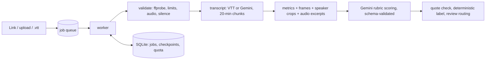

# ♟️ 8x8 Class Quality Assessor

**Live app:** https://classroom-quality-ai.streamlit.app/ · **Design doc:** [DESIGN.md](DESIGN.md) ·
**Evaluation:** [eval/EVALUATION.md](eval/EVALUATION.md)

This app rates a recorded online class from **8x8** (a chess academy for children) as **Poor / Average / Good /
Excellent**. It explains the rating with timestamped, transcript-verified evidence and gives coaching tips. When a
result is uncertain, it goes to **human review** instead of being shown as certain.

Built for the HUMANITI AI "Can You Teach AI to Recognise a Great Class?" challenge.

## Using it

1. **Link tab (recommended):** paste a Google Drive *file* link shared as "Anyone with the link → Viewer", or a
   direct URL. The server streams the file to disk with progress and resumes dropped connections (≤ 2 GB, ≤ 3 h).
2. **Upload tab:** for files up to 400 MB. Above about 200 MB, browser uploads can stall, so use a link instead.
3. Optionally attach the Zoom `.vtt`. It is faster and cheaper, and gives better speaker labels.
4. The job runs in the background and the page shows each stage as it goes:
   download & checks → transcribe → score → report.

The report shows:
- the rating, score and confidence;
- the six rubric dimensions, each with evidence;
- each quote marked as verified against the transcript or flagged;
- red flags, strengths and coaching tips;
- the camera/background/lighting check and the interaction metrics;
- the review banner and its reasons, when the class needs review;
- the model, prompt version, rubric version and estimated cost.

The **Ops** page shows jobs by status, failure reasons, the review rate and average cost/time per class.

## How it works (short)



- **Rubric from 8x8's own feedback.** Six dimensions: rapport & opening (20%), individual engagement (15%),
  teaching clarity (10%), energy & warmth (25%), structure/closure/homework (10%), professional setup & A/V (20%).
- **The LLM scores, code decides the label.** The label comes from a fixed weighted score with calibrated
  thresholds, and a major red flag caps it at Average.
- **Failure handling.** Validation runs before any spend. Downloads are streamed and resumable. Gemini calls use
  backoff with jitter, a model fallback chain and a circuit breaker. Malformed JSON gets one repair retry. Each
  job has a token/cost budget, and there is a daily quota guard. Checkpoints make retries resume where they
  stopped. If a signal is missing, the job continues with less (and says so).
- Full detail, trade-offs, the failure-mode table, scaling and cost estimates: **[DESIGN.md](DESIGN.md)**.

## Results (10 labelled sample classes)

- **Final setup:** 7/10 exact and 9/10 within one level in-sample. With leave-one-out thresholds it is 5/10 exact.
- **Quality-issue classes:** both are rated Poor. They are caught by the video and audio checks, not the
  transcript.
- **Quotes:** 141 of 144 evidence quotes verified against the transcripts.
- **Review routing:** 6 of 10 classes would go to review, including 2 of the 3 misclassified ones.
- **End-to-end** on a real 38-minute recording via a Drive link: 122 s, about $0.017 (estimate).

See [eval/EVALUATION.md](eval/EVALUATION.md).

## Run locally

Requires Python 3.12 (3.10+ works) and `ffmpeg` on PATH.

```bash
python3 -m venv .venv && source .venv/bin/activate
pip install -r requirements.txt
mkdir -p .streamlit && echo 'GEMINI_API_KEY = "your-key"' > .streamlit/secrets.toml   # or export GEMINI_API_KEY=...
streamlit run app.py
```

**CLI / batch (the at-scale path):**

```bash
python -m classqa.cli assess recording.mp4 --vtt transcript.vtt
python -m classqa.cli assess "https://drive.google.com/file/d/<id>/view"
python -m classqa.cli batch /path/to/folder --out results/ --workers 2   # or a links.txt (one link per line)
```

Batch runs write `summary.csv` and `reports.jsonl`. Re-running an interrupted batch reuses its checkpoints.

**Tests and lint** (no API key or network needed; fakes and synthetic ffmpeg media):

```bash
pip install pytest ruff && ruff check . && pytest -q
```

CI runs both in `.github/workflows/ci.yml`.

### Configuration (env vars)

| Variable | Default | Purpose |
|---|---|---|
| `GEMINI_API_KEY` | – | Streamlit secret or env var |
| `CLASSQA_MODEL` / `CLASSQA_TRANSCRIBE_MODEL` / `CLASSQA_FALLBACK_MODELS` | `gemini-3.5-flash-lite` / `gemini-3.1-flash-lite-preview` / chain | model selection |
| `CLASSQA_DAILY_REQUEST_LIMIT` | 400 | global daily request guard |
| `CLASSQA_JOB_TOKEN_BUDGET` / `CLASSQA_JOB_COST_BUDGET_USD` | 2,000,000 / 0.50 | per-job budget |
| `CLASSQA_MAX_BYTES` / `CLASSQA_MAX_DURATION_S` | 2 GB / 3 h | input limits |
| `CLASSQA_BORDERLINE_MARGIN` | 0.05 | how close to a threshold triggers review |
| `CLASSQA_CHECKPOINT_TTL_S` | 7 days | checkpoint retention |
| `CLASSQA_DB` / `CLASSQA_DATA_DIR` | `.cache/` | SQLite path / job work dirs |

## Deploy (Streamlit Community Cloud)

1. Point the app at this repo: branch `main`, main file `app.py`, Python 3.12.
2. `packages.txt` installs ffmpeg; `requirements.txt` installs the Python dependencies.
3. Add the secret `GEMINI_API_KEY`.
4. The app runs one background worker thread in the single container. SQLite lives on the container's ephemeral
   disk. If the container restarts mid-job, the job is marked `worker_restarted` and can be retried.

## Project layout

```
app.py, pages/1_Ops.py    Streamlit UI (submit + poll, ops dashboard)
ui/                       report view, runtime singletons
classqa/pipeline.py       staged, checkpointed processing core
classqa/worker.py         job runner (background thread), cleanup, ops summary
classqa/store.py          job model + SQLite store (jobs, checkpoints, quota) behind protocols
classqa/llm.py            Gemini client: backoff, fallback, circuit breaker, schema repair, budgets
classqa/quality.py        quote verification, self-consistency, review routing
classqa/media.py          validation, streaming download, ffmpeg audio/frames/signals
classqa/transcript.py     VTT parsing, teacher detection, pseudonymisation
classqa/metrics.py        objective interaction metrics
classqa/rubric.py         dimensions, anchors, weights, thresholds, rubric version hash
classqa/prompts.py        versioned prompts
classqa/obs.py            JSON logging, stage timing, token/cost accounting
classqa/errors.py         typed failures with error codes and user messages
classqa/cli.py            CLI / batch
eval/                     eval harness, offline rescoring and review analysis, results
tests/                    unit tests for every failure path (fakes only)
```

## Limitations

- Calibrated on only 10 labelled classes, and the thresholds were fitted on the same data.
- Run-to-run variance can move borderline classes by one level. Those are routed to review, and optional
  self-consistency helps.
- The background/face check is still judged by the LLM and is not stable on every class (see EVALUATION).
- Free-tier Gemini quotas limit throughput, so use a paid key for real use.

## Privacy

- Recordings of minors are written only to a per-job temp folder. They are sent **only to the Gemini API** and
  deleted when the job ends, whether it succeeds or fails. Gemini Files uploads, if any, are deleted too.
- Zoom display names are pseudonymised before scoring, and the model is told never to output names.
- Checkpoints (pseudonymised transcripts and model JSON) expire after 7 days. Logs contain no transcript text.
- No recordings, transcripts, feedback PDFs, names, keys or tokens are committed to this repo.
- Using Gemini for real 8x8 data requires the organiser's approval of the vendor (DPA, paid tier, retention); see
  DESIGN.md §9.
