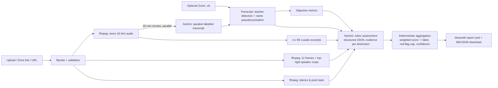

# ♟️ 8x8 Class Quality Assessor

A Streamlit app that takes a recorded online class from **8x8** (an online chess academy for children), rates it
**Poor / Average / Good / Excellent**, and explains the rating with **specific, timestamped, quoted evidence** and
coaching tips for the teacher.

Built for the HUMANITI AI "Can You Teach AI to Recognise a Great Class?" challenge.

## What it does

1. You upload a recording (mp4/mov/mkv/webm or audio) **or** paste a Google Drive / direct link.
   Optionally attach the Zoom `.vtt` transcript (faster, and saves API quota).
2. The app produces a report card:
   - big overall rating, weighted rubric score (1–5) and confidence;
   - six rubric dimension scores with a chart, each backed by 2–4 timestamped observations + quotes;
   - red flags (minor/major), strengths, and improvements with a concrete coaching tip each;
   - a setup check from the video (camera on, face visible, 8x8 branded background, lighting, screen share);
   - objective interaction metrics (talk-time split, questions and student turns per 10 min, how many children
     spoke, longest teacher monologue, longest silence, praise rate, homework and A/V-problem mentions);
   - downloadable Markdown / JSON report.

## How it works



**Why this design**

- **Multimodal on purpose.** 8x8's own reviewer feedback (see `EVALUATION.md`) is as much about *how the class looks
  and sounds* (8x8 branded background, teacher's face visible, energetic and pleasant voice, quality issues) as
  about what is said. So the model sees the transcript, sampled frames, zoomed crops of the speaker thumbnail
  (during screen share the teacher is a tiny tile in the top-right corner — full frames alone missed it), and
  short audio excerpts for tone.
- **Rubric derived from the client's feedback, not invented.** Six dimensions: rapport & opening (20%),
  individual engagement (15%), teaching clarity (10%), energy & warmth (25%), structure/closure/homework (10%),
  professional setup & A/V (20%). Each has 1/3/5 anchors (`classqa/rubric.py`).
- **The LLM scores, code decides.** Gemini returns per-dimension scores with evidence (Pydantic `response_schema`,
  so output is always valid JSON). The final label is a fixed weighted score with thresholds calibrated on the
  labelled sample set, plus a rule that a *major* red flag (unprofessional language, camera off most of the class,
  A/V problems that make the class hard to follow) caps the rating at Average. This is more stable and auditable
  than asking for a label directly; the model's holistic label is kept as a cross-check and lowers confidence when
  it disagrees.
- **Objective metrics as grounding.** Computed locally from the transcript so claims like "few children spoke"
  can be checked against numbers, and shown to the user.
- **Signals that turned out misleading** (documented in `EVALUATION.md`): raw frame brightness (dark Lichess/Zoom
  themes looked like "poor lighting"), and "teacher asks children individually" (present in almost every class,
  even weak ones, so it barely separates labels).
- **Robustness.** Retries with exponential backoff on 429/5xx, model fallback chain, transcription in parallel
  20-minute chunks (accurate timestamps, no output truncation on 90-minute classes), result cache keyed on file
  hash + prompt version, clear errors for bad links/unsupported/too-short files.

## Run locally

Requires Python 3.10+ and `ffmpeg` on PATH.

```bash
python3 -m venv .venv && source .venv/bin/activate
pip install -r requirements.txt
mkdir -p .streamlit && echo 'GEMINI_API_KEY = "your-key"' > .streamlit/secrets.toml   # or: export GEMINI_API_KEY=...
streamlit run app.py
```

Optional env vars: `CLASSQA_MODEL` (default `gemini-3-flash-preview`), `CLASSQA_FALLBACK_MODELS`.

## Deploy (Streamlit Community Cloud)

1. Point a new app at this repo, main file `app.py`.
2. `packages.txt` installs ffmpeg; `requirements.txt` installs Python deps.
3. In *Settings → Secrets* add `GEMINI_API_KEY = "..."`.
4. Upload limit is raised to 1 GB in `.streamlit/config.toml`. For very large files use a Google Drive link
   (shared as "Anyone with the link").

## Evaluation

`eval/run_eval.py` runs the full pipeline on the labelled sample classes and prints predicted vs actual labels
(anonymised IDs only; raw outputs go to the git-ignored `eval/runs/`). Iterations and results: **[EVALUATION.md](EVALUATION.md)**.

```bash
python eval/run_eval.py --data "/path/to/class recordings" --tag v3            # uses provided .vtt transcripts
python eval/run_eval.py --data "/path/to/class recordings" --tag v3 --mode full --only AV-1   # Gemini transcription
```

## Project layout

```
app.py                 Streamlit UI
classqa/media.py       download, ffprobe, audio extraction, frames/crops, silence & pixel stats
classqa/transcript.py  VTT parsing, teacher detection, name pseudonymisation, transcript rendering
classqa/metrics.py     objective interaction metrics
classqa/rubric.py      dimensions, anchors, weights, thresholds
classqa/schemas.py     Pydantic response schemas for Gemini
classqa/llm.py         Gemini client: retries, fallback, cache, usage stats
classqa/pipeline.py    orchestration + prompts + deterministic aggregation
classqa/report.py      Markdown report
eval/run_eval.py       evaluation harness
```

## Limitations

- Calibrated on only 10 labelled classes (2 per label + 2 "known quality issue"); thresholds may need retuning on
  more data. Run-to-run LLM variance can move borderline classes by one level (confidence is reported).
- Tone/energy is judged from four 90-second excerpts, not the full audio (quota trade-off).
- Visual checks rely on 12 frames and assume Zoom's layout for the speaker crop; other layouts still get full frames.
- Speaker attribution in Gemini transcripts is "Teacher" vs "Student" by voice/context and can be wrong; the
  provided Zoom `.vtt` gives better attribution when available.
- Non-English classes are translated during transcription; nuance can be lost.
- Free-tier Gemini quotas can slow a run; the app retries and falls back between models.

## Privacy

Recordings involve minors. The app writes the upload to a temporary folder, sends audio/frames **only to the Gemini
API**, and deletes the temp folder after the report is built. Real names are replaced by labels (`Teacher`,
`Student 1`…) before the transcript is sent for assessment, and the model is instructed never to output names.
No recordings, transcripts, frames or results are committed to this repository (`.gitignore` blocks media, `.vtt`,
`data/`, `eval/runs/`, `.env` and `secrets.toml`). Note: the analysis cache (`.cache/`) stores only the model's JSON output.
